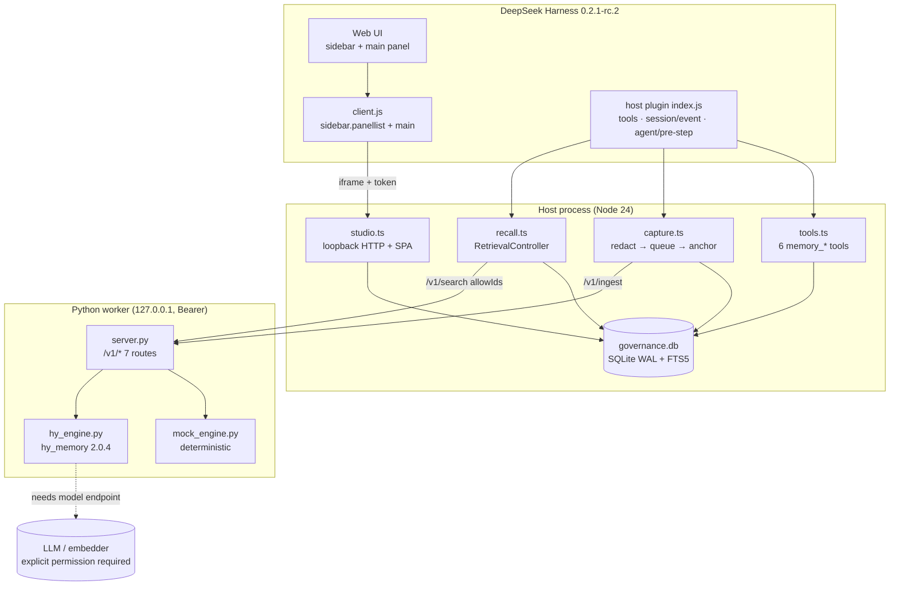
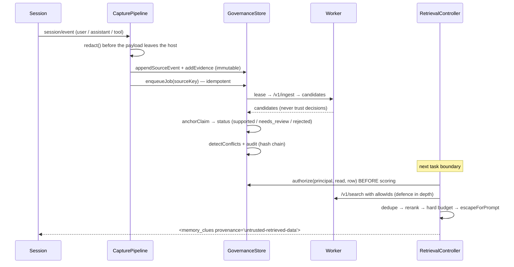

# HyMemory Studio for DeepSeek Harness

> **Windows preview — accepted scope, not GA.** DSH installation, the real Host/Studio iframe, and settings persistence passed the selected preview checks. Native Agent turns and Linux/macOS remain unverified. See [publication status](PUBLICATION_STATUS.md), the [verification report](docs/REMEDIATION_REPORT.md), and the [GitHub source repository](https://github.com/xiemonb666/dsh-hy-memory).
> Local validation screenshots are intentionally omitted from this public snapshot and remain local.


Long-term project memory for DSH agents, with evidence, access control and
version validity. A host plugin, a loopback Python worker, a governance store,
and a 9-page local Studio UI.

Version 0.1.0 · Apache-2.0 · Node ≥ 24 · Python ≥ 3.12

> **Windows preview status.** The selected Windows preview scope is accepted;
> this does not claim the full project plan or support on other platforms.
> Current evidence and remaining gaps are tracked in
> [the remediation report](docs/REMEDIATION_REPORT.md).

## Why it exists

An agent that remembers everything it is told will eventually believe something
that stopped being true, or believe something it made up. This plugin takes the
opposite position: memory is a **governed claim**, not a transcript.

- Every memory carries a status (`proposed → needs_review → supported →
  verified`, plus `conflicted / stale / superseded / rejected / deleted`), a
  version history, and evidence references.
- `verified` requires a real passing validation record **and** trusted evidence.
  A model's own statement can never satisfy either.
- Recall is ACL-first: candidates are authorized **before** scoring, and
  cross-project reads require an explicit grant, including for the owner.
- Injected memory is untrusted data inside a delimited container, escaped, and
  capped by a hard token budget measured on the rendered output.
- Code-bound memories know which commit and file they describe, and say
  `unknown` rather than `fresh` when they cannot prove it.

## Architecture



Capture and recall, in the order the code runs them:



## Quick start

```powershell
# 1) dependencies
& $node $pnpm install          # node/pnpm come from the DSH runtime
# the worker is stdlib-only; hy-memory is an optional extra (pyproject.toml:11-13)
.\.venv\Scripts\python.exe -m pip install ".[hy,test]"

# 2) build the Studio SPA, then the bundle
& $node $pnpm --filter @dsh-hy-memory/ui-client build
node scripts\build.mjs

# 3) verify the pipeline without DSH
$env:HYMEM_DATA_DIR = (Resolve-Path artifacts\e2e-data).Path
node dist\bundle\cli.js capture --json --text "Please remember the project uses pytest and that I prefer Python 3.12 for this repo."
node dist\bundle\cli.js search  --json --query "Which Python version and test runner does the project use?"
node dist\bundle\cli.js status  --json

# 4) run the Studio headless
node dist\bundle\cli.js serve --json --ui-port 48731

# 5) install into a DSH profile
node dist\bundle\cli.js install --profile hymem-spike --json
```

`$node` / `$pnpm` on this machine:

```powershell
$node = "$env:LOCALAPPDATA\Programs\DeepSeek Harness\resources\runtime\primary-runtime\dependencies\node\bin\node.exe"
$pnpm = "$env:LOCALAPPDATA\Programs\DeepSeek Harness\resources\runtime\primary-runtime\dependencies\pnpm\bin\pnpm.cjs"
```

Then open the Studio at
`http://127.0.0.1:48731/studio/?token=<contents of %LOCALAPPDATA%\dsh-hy-memory\ui-token>`,
or click **HyMemory 记忆台 / HyMemory Studio** in the DSH sidebar.

## Supported platforms

| Platform | Status |
|---|---|
| Windows 11 x64 (build 26200), Node 24.21.0, Python 3.12.14 | Primary validation environment; see the [current remediation report](docs/REMEDIATION_REPORT.md) for completed checks and pending runs |
| Linux / macOS | **coded, unverified** — XDG data path (`config.ts:110-111`), POSIX path separator for `PYTHONPATH` (`worker.ts:80`), `realpathSync.native` (`coding-trace`). No run on this machine |
| Node < 24 | **unsupported** — `node:sqlite` + FTS5 are required (`db.ts:10`, `package.json:9-11`) |
| Python < 3.12 | **unsupported by this worker** — see `pyproject.toml` |
| A real LLM/embedder endpoint | Synthetic-only isolated online tests were run; the default mock E2E suite remains offline |

## Feature matrix

Legend: **works** = proven by a command/test in this repo · **partial** = works
with a stated gap · **no** = not implemented.

| Capability | Status | Proof |
|---|---|---|
| Session capture (user/assistant/tool events) | works | `capture.ts:179-273`; CLI `capture` exit 0 |
| Secret redaction before persistence (13 patterns) | works | `redact.ts:34-48`; `tests/security/pollution.spec.ts:143` |
| Immutable evidence with trust levels | works | `governance/src/index.ts:394-446`; `tests/unit/governance.spec.ts:155` |
| Evidence gate (`anchorClaim`) | works | `evidence.ts:119-182`; `tests/security/pollution.spec.ts:45,78,93` |
| Memory state machine + optimistic revisions | works | `contracts/src/index.ts:34-44`; `tests/unit/governance.spec.ts:41,64` |
| `verified` needs a validation record + trusted evidence | works | `governance/src/index.ts:679-693` |
| Version history | works | `governance/src/index.ts:528-535, 727-731`; T-P06 |
| Conflict detection + 4-way resolution | works | `governance/src/index.ts:754-842`; `tests/unit/governance.spec.ts:88` |
| Tombstones (deleted stays deleted, even after FTS rebuild) | works | `tests/security/pollution.spec.ts:194` |
| Hash-chained audit log | works | `governance/src/index.ts:1145-1188`; `tests/unit/governance.spec.ts:260` |
| ACL: default-deny, grants, revocation, expiry | works | `governance/src/index.ts:281-388`; G-MULTIAGENT |
| ACL-first hybrid retrieval | works | `retrieval/src/index.ts:488-512`; `tests/unit/retrieval.spec.ts:136,159` |
| Hard token budget on the rendered container | works | `retrieval/src/index.ts:640-664`; T-C02, 0 violations |
| Prompt-injection containment (escaped data container) | works | `retrieval/src/index.ts:267-273`; T-C07 |
| Echo rejection (recall cannot be re-ingested) | works | `capture.ts:358`; `tools.ts:172`; T-P04 |
| Code bindings + freshness (`fresh/conditional/stale/unknown`) | works | `coding-trace/src/index.ts:573-681`; G-STALENESS |
| Workspace identity from canonical remote | works | `coding-trace/src/index.ts:416-457`; `tests/unit/coding-trace.spec.ts:101` |
| 6 model-facing tools | works | `tools.ts:37-372`; registered synchronously at activation (`index.ts:186-197`) |
| 7 worker HTTP routes with Bearer auth | works | `server.py:392-402`; current Python test result is in the remediation report |
| Studio API (24 endpoints) | works | `studio.ts:353-803`; mock E2E suite 15 checks, see current report |
| Studio UI (9 pages × 3 viewports × 2 themes) | works | mock UI acceptance 20 checks; local screenshots are omitted from this public snapshot |
| CLI (11 commands) | works | `scripts/cli.ts:562-588` |
| DSH sidebar entry + panel + iframe | verified for the Windows preview | Isolated Native Host gate passed 8 checks across 9 routes; the desktop iframe rendered Studio. See the [remediation report](docs/REMEDIATION_REPORT.md) for scope and limits. |
| Host plugin activation in a profile | verified for the tested Windows preview | The isolated Host gate and current desktop installation passed; a live native Agent round remains NOT_RUN. |
| Reads while the worker is down | works | Mock E2E confirms memory list/overview remain readable in degraded mode; it does not claim automatic worker restart |
| Real Hy-Memory SDK + semantic retrieval | works for the isolated smoke | Synthetic-only online harness: 15/15 checks, `hy-memory` 2.0.4, semantic-only clue; provider token usage is UNKNOWN. See the [report](docs/REMEDIATION_REPORT.md) |
| MemHub backend | **no** | settings enum only (`contracts/src/index.ts:475`) |
| Job cancellation | **yes** | `GovernanceStore.cancelJob` (`governance/src/index.ts:970-986`); an `active` job is withdrawn through the memory delete path |
| `POST /api/jobs/:id/cancel` | **yes** | `GovernanceStore.cancelJob` (`governance/src/index.ts:970-986`); refuses an `active` job, which must be withdrawn through the memory delete path |
| Retrieval-value paired smoke (no memory vs recall) | limited smoke | Three pairs: fact hit and actual answer citation were both **0/3 vs 3/3**; one synthetic fact/model, not a general quality benchmark. See the [report](docs/REMEDIATION_REPORT.md) |
| CLI `restore` / `reindex` / `migrate` executing | **yes** | isolated maintenance unit and mock E2E checks; see the remediation report |
| Coding engine ids via `/v1/get` (SDK 2.0.4) | **no** | `hy_engine.py:268-273` |
| Linux / macOS | **no** | coded for it, never run there |

## Current validation

The current run record is in [docs/REMEDIATION_REPORT.md](docs/REMEDIATION_REPORT.md).
It records Python 40/40 plus Ruff, TypeScript 260/260, and mock E2E at 5 suites / 65 checks / 0 failures / 0 skips.
The synthetic online SDK/semantic smoke passed 15/15 checks; its paired A/B was
three runs per arm and does not establish general retrieval quality. The Windows
preview installation, Host gate, and desktop iframe are verified for the stated
scope. Native Agent turns, Linux/macOS, and live DSH multi-agent acceptance remain NOT_RUN.

## What is not implemented

1. **MemHub backend.** `backend: 'memhub'` exists as a settings enum only
   (`contracts/src/index.ts:475`); no adapter exists.
2. **Online validation is separate from mock E2E.** `pnpm run test:e2e` uses the
   deterministic mock engine. The opt-in synthetic online evidence and its
   limits are recorded in the remediation report; SDK adapter counters do not
   provide provider token usage.
3. **A general retrieval-quality benchmark.** The online paired smoke measures
   one synthetic fact, one question, one model and three pairs. It is not a
   quality benchmark over a labelled set.
4. **Platform and native installation acceptance.** The current maintenance CLI
   executes rebuild/migration and validated restore; actual profile lifecycle
   and platform results still need their own integration evidence.
5. **Coding memory ids via `/v1/get`.** The SDK hides `L1_RAW` ids, so coding
   memories are addressed through the governance database
   (`hy_engine.py:268-273`).
6. **`symbolsFromDiff`.** Heuristic line scanning, not an AST
   (`coding-trace/src/index.ts:712-720`).
7. **Live DSH multi-agent acceptance is not run.** Offline principal/CAS tests do
   not prove a real DSH sub-agent spawn or identity. See the report and
   [docs/E2E_MATRIX.md](docs/E2E_MATRIX.md).
8. **Linux / macOS.** Coded for it, never run there.

## Repository layout

```
packages/
  contracts/        schemas, ids, token budget, prompt markers
  governance/       SQLite store, ACL, evidence gate, state machine, audit
  retrieval/        ACL-first hybrid retrieval, rerank, hard budget, rendering
  coding-trace/     git probe, workspace identity, freshness, diff chain
  host-plugin/      plugin entry, capture, recall, tools, Studio API, worker
  ui-client/        React 19 Studio SPA (9 pages)
python/
  hymem_worker/     loopback HTTP worker, mock engine, hy_memory adapter
  tests/            offline tests; current result in remediation report
  research_smoke.py real-SDK smoke test with a local mock [OI] server
scripts/            build.mjs, cli.ts, benchmark.mjs, run-benchmark.mjs
tests/
  unit/             offline unit tests
  security/         offline security tests (G-POLLUTION / STALENESS / CONTEXT / MULTIAGENT)
  e2e/              cross-session.mjs, api-e2e.mjs, operations.mjs,
                    ui-acceptance.mjs, dsh-integration.mjs, screenshots.mjs
docs/               IMPLEMENTATION_REPORT, SECURITY_AUDIT, BENCHMARK_REPORT,
                    OPERATIONS, USER_GUIDE.zh-CN, E2E_MATRIX,
                    internal/{API_CONTRACT,DSH_API_MAP}
  Local validation screenshots are intentionally omitted from this public snapshot; retained locally.
LICENSE, NOTICE     Apache-2.0 text + third-party attribution
```

## Documentation

| Document | Contents |
|---|---|
| [docs/README.md](docs/README.md) | documentation map and the invariants every doc follows |
| [docs/IMPLEMENTATION_REPORT.md](docs/IMPLEMENTATION_REPORT.md) | per-work-package proof format: files, APIs, commands, exit codes, evidence |
| [docs/SECURITY_AUDIT.md](docs/SECURITY_AUDIT.md) | threat model, mechanisms, the test that proves each mitigation, residual risk |
| [docs/BENCHMARK_REPORT.md](docs/BENCHMARK_REPORT.md) | measured offline numbers, dataset shapes, what is not measured |
| [docs/OPERATIONS.md](docs/OPERATIONS.md) | install/upgrade/backup/restore/migrate/reindex, paths, logs, degraded modes, rollback |
| [docs/USER_GUIDE.zh-CN.md](docs/USER_GUIDE.zh-CN.md) | 中文用户指南 |
| [docs/E2E_MATRIX.md](docs/E2E_MATRIX.md) | all 20 acceptance IDs → the test that proves each, with its command |
| [docs/internal/API_CONTRACT.md](docs/internal/API_CONTRACT.md) | the frozen HTTP contract for the worker and the Studio API |
| [docs/internal/DSH_API_MAP.md](docs/internal/DSH_API_MAP.md) | the DSH extension points this plugin uses, with source citations |

## Tests

```powershell
.\node_modules\.bin\vitest.CMD run --reporter=verbose        # latest recorded: 255 passed
.\.venv\Scripts\python.exe -m pytest python/tests -q         # latest recorded: 40 passed
.\.venv\Scripts\python.exe -m ruff check python
.\node_modules\.bin\tsc.CMD -p tsconfig.json --noEmit
node scripts\run-benchmark.mjs                               # NOT scripts\benchmark.mjs
node tests\e2e\cross-session.mjs                             # check count varies; see report
node tests\e2e\api-e2e.mjs                                   # needs a running Studio
node tests\e2e\operations.mjs                                # standalone suite
node tests\e2e\ui-acceptance.mjs                             # standalone suite
```

`package.json` also exposes these as `pnpm test`, `pnpm test:python`,
`pnpm test:e2e`, `pnpm test:dsh`, `pnpm benchmark:offline`, `pnpm doctor`,
`pnpm status`, `pnpm serve`, `pnpm install:plugin`, `pnpm uninstall:plugin`,
`pnpm backup`, `pnpm screenshots`.

## License and NOTICE

This project is **Apache-2.0**. The license text is in
[LICENSE](LICENSE); third-party attribution is in [NOTICE](NOTICE). Both files
exist at the repository root.

| Component | License | Verification |
|---|---|---|
| `hy-memory` 2.0.4 (PyPI, source HEAD `8f1c4045e913566a6f40eb4451d68218b2307773`) | **Apache-2.0** | `hy_memory-2.0.4.dist-info/METADATA`: `License-Expression: Apache-2.0`, `Requires-Python: >=3.9`, `License-File: LICENSE` |
| DeepSeek Harness 0.2.1-rc.2 (build `332895e0f7c9d4dbfb29729f5eb367fa263ff986`) | **MIT** (declared by the upstream project) | **not verified on this machine** — DSH ships inside `resources/app.asar`, which I cannot read as files here. The `NOTICE` states MIT as the upstream declaration |

**NOTICE requirements.** Because this project is Apache-2.0 and incorporates
Apache-2.0 `hy-memory` behaviour (its SDK is imported at runtime, not vendored), a
redistributed build must carry the Apache-2.0 license text and preserve the
upstream `NOTICE` content if the upstream distribution has one, plus attribution
for DSH under its MIT terms. `NOTICE` records both, together with Node, React,
the build tooling, and the Python transitive dependencies of `hy-memory`
(installed by pip, not vendored). Review the installed distributions before
redistribution; `NOTICE` says so explicitly.

## Not affiliated

This is an independent plugin. It is not an official DeepSeek Harness component
and is not endorsed by DeepSeek or by the Hy-Memory authors.


