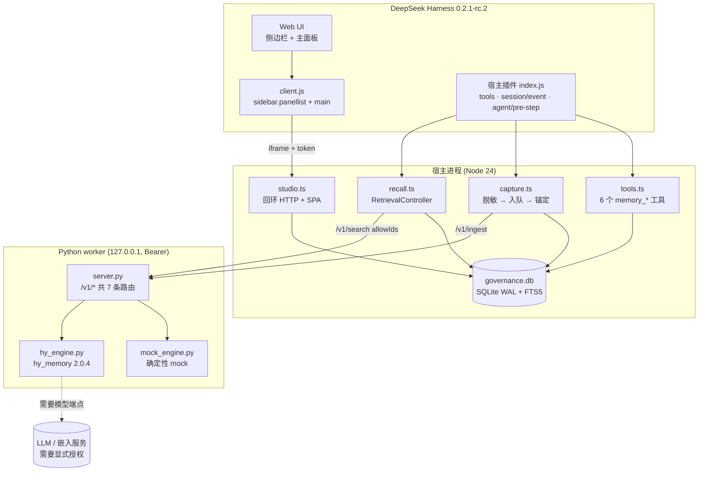
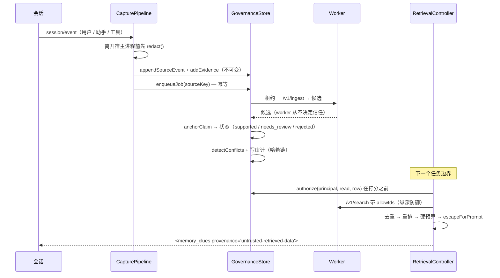

# HyMemory Studio for DeepSeek Harness

> **Windows 预览版（本轮范围已验收，非 GA）** — DSH 安装、真实 Host/Studio iframe 与设置持久化通过本轮预览检查。原生 Agent 回合及 Linux/macOS 仍未验证。请查看[发布状态](PUBLICATION_STATUS.md)、[复验报告](docs/REMEDIATION_REPORT.md)和[GitHub 源码仓库](https://github.com/xiemonb666/dsh-hy-memory)。
> 本地验收截图未纳入公开快照，仅保留在本地。


为 DSH 智能体提供**带证据、带权限、带版本有效性**的长期项目记忆。包含宿主插件、
本地回环 Python worker、治理数据库，以及一个 9 页的本地 Studio 界面。

版本 0.1.0 · Apache-2.0 · Node ≥ 24 · Python ≥ 3.12

> **状态：Windows 预览范围已验收。** 这不代表完整工程计划完成或支持其他平台。
> 当前证据与剩余范围见[本轮复验记录](docs/REMEDIATION_REPORT.md)。

## 它解决什么问题

一个「什么都记住」的智能体会慢慢相信已经失效的结论，或者相信自己编造的内容。
本插件的立场相反：记忆是**受治理的断言**，不是聊天记录。

- 每条记忆都有状态（`proposed → needs_review → supported → verified`，以及
  `conflicted / stale / superseded / rejected / deleted`）、版本历史和证据引用；
- `verified` 需要**真实通过的 validation 记录**加上**可信证据**，模型自己的话
  两条都不满足；
- 召回是 ACL 优先：候选在**打分之前**先鉴权，跨项目读取即使对 owner 也需要显式授权；
- 注入内容是被转义、被硬性 token 预算裁剪的「不可信数据容器」；
- 绑定代码的记忆知道自己描述的是哪个提交和文件；证明不了时给 `unknown`，
  绝不给 `fresh`。

## 架构



采集与召回的实际执行顺序：



## 快速开始

```powershell
# 0) 本机工具链位置
$node = "$env:LOCALAPPDATA\Programs\DeepSeek Harness\resources\runtime\primary-runtime\dependencies\node\bin\node.exe"
$pnpm = "$env:LOCALAPPDATA\Programs\DeepSeek Harness\resources\runtime\primary-runtime\dependencies\pnpm\bin\pnpm.cjs"

# 1) 依赖
& $node $pnpm install
# worker 只依赖标准库；hy-memory 是可选附加项（pyproject.toml:11-13）
.\.venv\Scripts\python.exe -m pip install ".[hy,test]"

# 2) 先构建 Studio 前端，再打包
& $node $pnpm --filter @dsh-hy-memory/ui-client build
node scripts\build.mjs

# 3) 不装 DSH 也能验证整条管线
$env:HYMEM_DATA_DIR = (Resolve-Path artifacts\e2e-data).Path
node dist\bundle\cli.js capture --json --text "Please remember the project uses pytest and that I prefer Python 3.12 for this repo."
node dist\bundle\cli.js search  --json --query "Which Python version and test runner does the project use?"
node dist\bundle\cli.js status  --json

# 4) 无 DSH 直接跑 Studio
node dist\bundle\cli.js serve --json --ui-port 48731

# 5) 装进 DSH profile
node dist\bundle\cli.js install --profile hymem-spike --json
```

打开 Studio：
`http://127.0.0.1:48731/studio/?token=<%LOCALAPPDATA%\dsh-hy-memory\ui-token 的内容>`，
或在 DSH 侧边栏点击 **HyMemory 记忆台**。

## 支持平台

| 平台 | 状态 |
|---|---|
| Windows 11 x64（build 26200），Node 24.21.0，Python 3.12.14 | 主要验证环境；已完成项和待跑项目见[当前复验报告](docs/REMEDIATION_REPORT.md) |
| Linux / macOS | **有代码、未验证** — XDG 数据目录（`config.ts:110-111`）、POSIX 路径分隔符（`worker.ts:80`）、`realpathSync.native`（`coding-trace`）；本机未运行 |
| Node < 24 | **不支持** — 需要 `node:sqlite` + FTS5（`db.ts:10`、`package.json:9-11`） |
| Python < 3.12 | **本 worker 不支持** — 见 `pyproject.toml` |
| 真实 LLM / 嵌入端点 | 已运行仅含合成数据的隔离在线测试；默认 mock E2E 仍离线运行 |

## 功能矩阵

图例：**可用** = 本仓库内有命令/测试证明 · **部分** = 可用但有明确缺口 ·
**未实现** = 不存在。

| 能力 | 状态 | 证据 |
|---|---|---|
| 会话采集（用户/助手/工具事件） | 可用 | `capture.ts:179-273`；CLI `capture` 退出 0 |
| 落盘前密钥脱敏（13 类模式） | 可用 | `redact.ts:34-48`；`tests/security/pollution.spec.ts:143` |
| 不可变证据 + 信任级别 | 可用 | `governance/src/index.ts:394-446`；`tests/unit/governance.spec.ts:155` |
| 证据闸门（`anchorClaim`） | 可用 | `evidence.ts:119-182`；T-P01/P02/P03 |
| 状态机 + 乐观版本 | 可用 | `contracts/src/index.ts:34-44`；`tests/unit/governance.spec.ts:41,64` |
| `verified` 需 validation + 可信证据 | 可用 | `governance/src/index.ts:679-693` |
| 版本历史 | 可用 | `governance/src/index.ts:528-535, 727-731`；T-P06 |
| 冲突检测 + 四种解决方式 | 可用 | `governance/src/index.ts:754-842`；`tests/unit/governance.spec.ts:88` |
| 墓碑（删除后 FTS 重建也不复活） | 可用 | `tests/security/pollution.spec.ts:194` |
| 哈希链审计 | 可用 | `governance/src/index.ts:1145-1188`；`tests/unit/governance.spec.ts:260` |
| ACL：默认拒绝、授权、撤销、过期 | 可用 | `governance/src/index.ts:281-388`；G-MULTIAGENT |
| ACL 优先的混合检索 | 可用 | `retrieval/src/index.ts:488-512`；`tests/unit/retrieval.spec.ts:136,159` |
| 按渲染结果计算的硬 token 预算 | 可用 | `retrieval/src/index.ts:640-664`；T-C02，0 次越界 |
| 提示注入隔离（转义数据容器） | 可用 | `retrieval/src/index.ts:267-273`；T-C07 |
| 回声拒绝（召回内容不能回写） | 可用 | `capture.ts:358`；`tools.ts:172`；T-P04 |
| 代码绑定 + 新鲜度（`fresh/conditional/stale/unknown`） | 可用 | `coding-trace/src/index.ts:573-681`；G-STALENESS |
| 从规范 remote 推导工作区身份 | 可用 | `coding-trace/src/index.ts:416-457`；`tests/unit/coding-trace.spec.ts:101` |
| 6 个面向模型的工具 | 可用 | `tools.ts:37-372`；在激活时同步注册（`index.ts:186-197`） |
| 7 条 worker HTTP 路由 + Bearer | 可用 | `server.py:392-402`；当前 Python 总测试结果见复验报告 |
| Studio API（24 个端点） | 可用 | `studio.ts:353-803`；mock E2E 套件 15 项，见当前报告 |
| Studio UI（9 页 × 3 断点 × 2 主题） | 可用 | mock UI 验收 20 项；本地截图未纳入公开快照 |
| CLI（11 个命令） | 可用 | `scripts/cli.ts:562-588` |
| DSH 侧边栏 + 面板 + iframe | Windows 预览已验证 | 隔离 Native Host gate 8 项检查、9 条路由通过；桌面 iframe 已显示 Studio，范围见[复验报告](docs/REMEDIATION_REPORT.md) |
| 宿主插件在 profile 内激活 | Windows 预览已验证 | 本轮隔离 Host gate 与桌面安装通过；真实原生 Agent 回合仍为 NOT_RUN |
| worker 不可用时仍可读取 | 可用 | mock E2E 验证 memory list/overview 在 degraded 状态仍可读；不声称自动重启 worker |
| 真实 Hy-Memory SDK 与语义检索 | 隔离 smoke 通过 | 仅合成数据 online harness 15/15；SDK 2.0.4，semantic-only 返回 clue；供应商 token usage 为 UNKNOWN。见[报告](docs/REMEDIATION_REPORT.md) |
| MemHub 后端 | **未实现** | 只有设置枚举（`contracts/src/index.ts:475`） |
| `POST /api/jobs/:id/cancel` | **已实现** | `GovernanceStore.cancelJob`（`governance/src/index.ts:970-986`）；对 `active` 任务返回 false，需走记忆删除路径 |
| 召回价值 paired smoke（无记忆 vs 有召回） | 有限 smoke | 3 组：事实命中与答案实际引用均为 **0/3 vs 3/3**；单一合成事实/模型，不是通用质量基准。见[报告](docs/REMEDIATION_REPORT.md) |
| CLI `restore` / `reindex` / `migrate` 真正执行 | **已实现** | 临时数据库单测及 mock 运维 E2E，见本轮复验记录 |
| SDK 2.0.4 的编码记忆 id 用 `/v1/get` 寻址 | **未实现** | `hy_engine.py:268-273` |
| Linux / macOS | **未实现** | 有代码，从未在那些平台运行 |

## 当前验证

当前实况记录于[docs/REMEDIATION_REPORT.md](docs/REMEDIATION_REPORT.md)。其中
Python 40/40 且 Ruff 通过，TypeScript 260/260 通过；mock E2E 为 5 套件 / 65 检查 / 0 失败 / 0 跳过。
合成数据 online SDK/语义 smoke 15/15；paired A/B 每组 3 次，不能据此宣称通用召回质量改善。
Windows 预览安装、Host gate 与桌面 iframe 已按本轮范围验证；原生 Agent 回合、Linux/macOS
和活 DSH 多智能体验收仍为 NOT_RUN。

## 未实现（必须知道）

1. **MemHub 后端**：`backend: 'memhub'` 只是设置枚举，没有适配器。
2. **在线验证与 mock E2E 分开**：`pnpm run test:e2e` 使用确定性的 mock 引擎。可选
   合成数据在线证据及其边界见复验报告；SDK adapter counter 不提供供应商 token usage。
3. **通用检索质量基准**：在线 paired smoke 只测一条合成事实、一个问题、一个模型、
   三组配对；不等于带标注集的质量基准。
4. **平台及原生安装验收**：Windows 预览安装和 Host/iframe 已验证；Linux/macOS 与原生
   Agent 回合仍需单独验收。
5. **编码记忆 id 用 `/v1/get`**：SDK 隐藏 `L1_RAW`，只能通过治理库寻址。
6. **`symbolsFromDiff`**：启发式行扫描，不是 AST。
7. **活 DSH 多智能体验收未运行**：离线 principal/CAS 测试不证明真实 DSH 子智能体
   spawn 或身份；见复验报告和 [docs/E2E_MATRIX.md](docs/E2E_MATRIX.md)。
8. **Linux / macOS**：有代码，从未在这些平台运行。

## 目录结构

```
packages/
  contracts/        模式、ID、token 预算、提示标记
  governance/       SQLite 存储、ACL、证据闸门、状态机、审计
  retrieval/        ACL 优先混合检索、重排、硬预算、渲染
  coding-trace/     git 探测、工作区身份、新鲜度、diff 链
  host-plugin/      插件入口、采集、召回、工具、Studio API、worker 监督
  ui-client/        React 19 Studio SPA（9 页）
python/
  hymem_worker/     回环 HTTP worker、mock 引擎、hy_memory 适配层
  tests/            离线测试；当前结果见复验报告
  research_smoke.py 真实 SDK 冒烟测试（本地 mock [OI] 服务器）
scripts/            build.mjs、cli.ts、benchmark.mjs、run-benchmark.mjs
tests/
  unit/             离线单元测试
  security/         离线安全测试（G-POLLUTION / STALENESS / CONTEXT / MULTIAGENT）
  e2e/              cross-session.mjs、api-e2e.mjs、operations.mjs、
                    ui-acceptance.mjs、dsh-integration.mjs、screenshots.mjs
docs/               IMPLEMENTATION_REPORT、SECURITY_AUDIT、BENCHMARK_REPORT、
                    OPERATIONS、USER_GUIDE.zh-CN、E2E_MATRIX、
                    internal/{API_CONTRACT,DSH_API_MAP}
  本地验收截图未纳入公开快照，仅保留在本地。
LICENSE、NOTICE     Apache-2.0 全文 + 第三方归属
```

## 文档

| 文档 | 内容 |
|---|---|
| [docs/README.md](docs/README.md) | 文档地图与所有文档共同遵守的写作约束 |
| [docs/IMPLEMENTATION_REPORT.md](docs/IMPLEMENTATION_REPORT.md) | 按工作包给出文件、API、命令、退出码、证据路径 |
| [docs/SECURITY_AUDIT.md](docs/SECURITY_AUDIT.md) | 威胁模型、机制、每条缓解对应的测试、剩余风险 |
| [docs/BENCHMARK_REPORT.md](docs/BENCHMARK_REPORT.md) | 实测离线数字、数据集形状、未测内容 |
| [docs/OPERATIONS.md](docs/OPERATIONS.md) | 安装/升级/备份/恢复/迁移/重建索引、路径、日志、降级、回滚 |
| [docs/USER_GUIDE.zh-CN.md](docs/USER_GUIDE.zh-CN.md) | 中文用户指南 |
| [docs/E2E_MATRIX.md](docs/E2E_MATRIX.md) | 20 项验收 ID → 证明它的测试 + 命令 |
| [docs/internal/API_CONTRACT.md](docs/internal/API_CONTRACT.md) | worker 与 Studio API 的冻结契约 |
| [docs/internal/DSH_API_MAP.md](docs/internal/DSH_API_MAP.md) | 本插件使用的 DSH 扩展点（附源码引用） |

## 测试

```powershell
.\node_modules\.bin\vitest.CMD run --reporter=verbose        # 最近记录：255 passed
.\.venv\Scripts\python.exe -m pytest python/tests -q         # 最近记录：40 passed
.\.venv\Scripts\python.exe -m ruff check python
.\node_modules\.bin\tsc.CMD -p tsconfig.json --noEmit
node scripts\run-benchmark.mjs                               # 不能直接跑 scripts\benchmark.mjs
node tests\e2e\cross-session.mjs                             # 11 项
node tests\e2e\api-e2e.mjs                                   # 15 项，需要 Studio 在跑
node tests\e2e\operations.mjs                                # 10 项
node tests\e2e\ui-acceptance.mjs                             # 20 项
```

`package.json` 也提供了 `pnpm test`、`pnpm test:python`、`pnpm test:e2e`、
`pnpm test:dsh`、`pnpm benchmark:offline`、`pnpm doctor`、`pnpm status`、
`pnpm serve`、`pnpm install:plugin`、`pnpm uninstall:plugin`、`pnpm backup`、
`pnpm screenshots`。

## 许可证与 NOTICE

本项目为 **Apache-2.0**，全文见 [LICENSE](LICENSE)；第三方归属见
[NOTICE](NOTICE)。两个文件都在仓库根目录。

| 组件 | 许可证 | 核实方式 |
|---|---|---|
| `hy-memory` 2.0.4（PyPI，源码 HEAD `8f1c4045e913566a6f40eb4451d68218b2307773`） | **Apache-2.0** | `hy_memory-2.0.4.dist-info/METADATA`：`License-Expression: Apache-2.0`、`Requires-Python: >=3.9`、`License-File: LICENSE` |
| DeepSeek Harness 0.2.1-rc.2（build `332895e0f7c9d4dbfb29729f5eb367fa263ff986`） | **MIT**（上游声明） | **本机未核实** — DSH 打包在 `resources/app.asar` 内，这里无法按文件读取；`NOTICE` 按上游声明记为 MIT |

**NOTICE 要求。** 本项目为 Apache-2.0，并集成了 Apache-2.0 的 `hy-memory`
（运行时 import 其 SDK，未内联源码），因此再分发时必须附带 Apache-2.0
许可证全文；若上游发行版带有 `NOTICE`，必须一并保留其内容；同时需按 MIT
条款保留 DSH 的版权与许可声明。`NOTICE` 已记录以上两项，以及 Node、React、
构建工具链，和 `hy-memory` 的 Python 传递依赖（由 pip 安装，未内联）。
再分发前请自行复核已安装的发行版；`NOTICE` 中对此有明确提示。

## 非官方声明

本项目是独立插件，不是 DeepSeek Harness 的官方组件，也未获得 DeepSeek 或
Hy-Memory 作者的背书。


