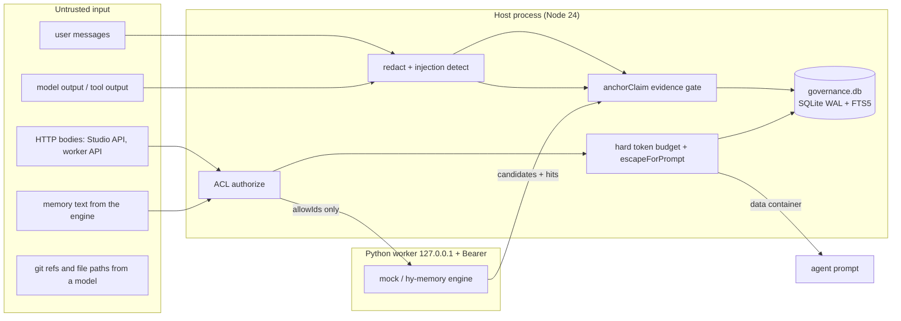

# Security Audit — DSH HyMemory Studio

> Historical audit. Current ACL, lease fencing, egress policy and backup validation changes are recorded in [REMEDIATION_REPORT.md](REMEDIATION_REPORT.md). The earlier test counts are not current revalidation.

Scope: `packages/*`, `python/hymem_worker/*`, `packages/host-plugin/client/client.js`,
as they exist at 2026-10-21. Method: read the code, then name the test that
proves each mitigation. Nothing here is a penetration test: it is a code-and-test
audit, exercised through the live loopback Studio API, `scripts/cli.ts`, and the
acceptance suites. The host plugin does activate in the running DSH desktop
process, but I did not drive an adversarial agent session against it.

Evidence commands used for this audit:

```
.\node_modules\.bin\vitest.CMD run --reporter=verbose        # exit 0, 7 files / 86 tests
.\.venv\Scripts\python.exe -m pytest python/tests -q         # exit 0, 30 passed
node tests\e2e\api-e2e.mjs                                   # exit 0, 15/15 checks
node tests\e2e\cross-session.mjs                             # exit 0, 11/11 checks
node tests\e2e\operations.mjs                                # exit 0, 10/10 checks
node tests\e2e\ui-acceptance.mjs                             # exit 0, 20/20 checks
```

> The engineering plan (§13.3, the adversarial-input list) is not present in
> this repository. The threat list below is reconstructed from the four
> implemented defence suites plus the adversarial cases the code visibly
> handles; where a threat is not covered by any test I say so. Per-ID coverage
> is in [E2E_MATRIX.md](E2E_MATRIX.md).

## 1. Assets and trust boundaries



Boundaries that carry security weight:

| Boundary | Direction | Control |
|---|---|---|
| Session events → capture buffer | in | `redact()` before the payload leaves the host (`capture.ts:191,201,226,247`) |
| Engine candidates → governance records | in | `anchorClaim` decides status, never the model (`capture.ts:362-411`) |
| Studio HTTP → governance store | in | token → cookie, CSRF header, ACL as `owner` |
| Host → worker HTTP | out | Bearer token, `127.0.0.1`, no CORS |
| Retrieval → agent prompt | out | ACL-first filter, status filter, hard budget, escaping |
| Memory text → new memory | in | echo rejection (`capture.ts:358`, `tools.ts:172`) |

## 2. The four hard problems

The repository's own acceptance suites are named after four problems, and the
code's defences line up with them one-to-one. Mapping:

| Hard problem | Suite | Where the defence lives |
|---|---|---|
| **Pollution** — a model claim becoming a trusted fact | G-POLLUTION (7 tests) | `packages/governance/src/evidence.ts`, state machine in `packages/governance/src/index.ts` |
| **Staleness** — memory outliving the code it describes | G-STALENESS (8 tests) | `packages/coding-trace/src/index.ts` |
| **Context cost** — unbounded or wasteful injection | G-CONTEXT (9 tests) | `packages/retrieval/src/index.ts` |
| **Multi-agent isolation** — one agent reading another's memory | G-MULTIAGENT (9 tests) | `GovernanceStore.authorize` + ACL-first retrieval + `allowIds` |

### 2.1 Pollution

Mechanisms: a deterministic evidence gate; a closed state machine; conflict
detection instead of overwrite; a `verified` transition that needs a real
validation record; echo rejection; redaction before persistence.

| Threat | Mechanism | Proof |
|---|---|---|
| Model claims "tests pass" while the tool exited 1 | `anchorClaim` detects `success_claim_against_failed_tool` and returns `needs_review`; `transition` refuses `verified` without a passing validation **and** trusted evidence | `tests/security/pollution.spec.ts:45` (T-P01); `tests/unit/governance.spec.ts:155`; gate at `packages/governance/src/evidence.ts:146-150`; state machine at `packages/governance/src/index.ts:679-693` |
| A summary silently drops "not established" | negation is compared between candidate and evidence; a dropped negation forces `needs_review` | `tests/security/pollution.spec.ts:78` (T-P02); `evidence.ts:135-145` |
| Repeating a claim 100× raises its trust | trust is the max over *distinct* evidence, and `model_generated` caps at `needs_review` | `tests/security/pollution.spec.ts:93` (T-P03); `evidence.ts:131-134, 158-161` |
| Recalled text is written back as a new fact | `looksLikeEcho` + `wasInjected` reject the write | `tests/security/pollution.spec.ts:112` (T-P04); `packages/contracts/src/index.ts:592-598`; `governance/src/index.ts:1022-1032`; enforced at `capture.ts:358` and `tools.ts:172` |
| Prompt injection / API keys in tool output get stored | secret patterns replaced with `[REDACTED:<kind>]` before persistence; injection categories recorded, never executed | `tests/security/pollution.spec.ts:143` (T-P05); `governance/src/redact.ts:34-61`; `tests/unit/governance.spec.ts:214,222` |
| A revision silently overwrites history | `updateMemory`/`transition` append a `memory_versions` row; conflicts become `conflict_cases` | `tests/security/pollution.spec.ts:164` (T-P06); `tests/unit/governance.spec.ts:88` |
| A deleted memory comes back | tombstone flag + `getMemory` returning `null` + FTS rebuild not resurrecting | `tests/security/pollution.spec.ts:194` (T-P07); `governance/src/index.ts:549-558, 714-725` |
| Invented numbers or file paths | numeric/path tokens must appear in the evidence, else `numbers_not_in_evidence` / `paths_not_in_evidence` | `tests/unit/governance.spec.ts:192`; `evidence.ts:151-156` |

### 2.2 Staleness

Mechanisms: code bindings, ancestor/revert checks, per-file content hashes,
and a four-valued verdict where "cannot prove" is `unknown`, never `fresh`.

| Threat | Mechanism | Proof |
|---|---|---|
| A function changed under an old conclusion | changed bound file → `stale`, or `conditional` when only a hash-less touch is known | `tests/security/staleness.spec.ts:44` (T-S01); `coding-trace/src/index.ts:641-668` |
| Recommending work that was reverted | revert bodies (`This reverts commit <sha>`) mark the target in `DiffChain.reverted` | `tests/security/staleness.spec.ts:56` (T-S02); `coding-trace/src/index.ts:500-521, 764-771, 802-835` |
| A docs-only change invalidates code memory | unrelated changed files yield `conditional`, not `stale` | `tests/security/staleness.spec.ts:70` (T-S03); `coding-trace/src/index.ts:673-677` |
| Same-named function on another branch is "the same fact" | branch divergence without a shared merge base is `stale` | `tests/security/staleness.spec.ts:83` (T-S04); `coding-trace/src/index.ts:616-623` |
| Shallow clone / detached HEAD yields a confident verdict | both short-circuit to `unknown` | `tests/security/staleness.spec.ts:96` (T-S05); `coding-trace/src/index.ts:583-584` |
| Re-validation rewrites the old record | new version row, old content readable | `tests/security/staleness.spec.ts:124` (T-S06); `tests/unit/governance.spec.ts:64` |
| Git option injection via a ref | refs validated against `SAFE_REF_RE` before argv use | `tests/unit/coding-trace.spec.ts:172`; `coding-trace/src/index.ts:209-212, 24` |

### 2.3 Context cost

Mechanisms: a hard budget measured on the *rendered* container, an information
floor that skips acknowledgement-only queries, a bounded cache keyed by ACL
revision, and a timeout that returns empty instead of blocking.

| Threat | Mechanism | Proof |
|---|---|---|
| Injection exceeds the budget | clues are selected against `estimateTokens(renderClues(...))`; oversized clues are skipped, then clues are popped | `tests/security/context-cost.spec.ts:114` (T-C02, budgets 120/300/600); `tests/unit/retrieval.spec.ts:169`; `retrieval/src/index.ts:640-664` |
| Repeated steps grow the payload | cache keyed by session+turn+query fingerprint+ACL revision+settings revision | `tests/security/context-cost.spec.ts:126` (T-C03); `retrieval/src/index.ts:666-685` |
| "ok, continue" triggers a full corpus search | `hasMeaningfulQuery` short-circuits before either channel | `tests/security/context-cost.spec.ts:140` (T-C04); `retrieval/src/index.ts:143-149, 345-348` |
| A dead engine blocks the turn | `searchWithTimeout` races a hard deadline; semantic channel failure degrades to keyword only | `tests/security/context-cost.spec.ts:156` (T-C05); `tests/unit/retrieval.spec.ts:378`; `retrieval/src/index.ts:431-460`; `sources.ts:80-83` |
| Memory content closes the data container / injects markup | `escapeForPrompt` entity-escapes `< > & \`` and strips control chars | `tests/security/context-cost.spec.ts:192` (T-C07); `tests/unit/retrieval.spec.ts:209`; `contracts/src/index.ts:568-575`; applied at `retrieval/src/index.ts:270-272` |
| A non-verified record is shown as VERIFIED | the label is the governance status verbatim | `tests/security/context-cost.spec.ts:219`; `retrieval/src/index.ts:207-214` |
| 10k memories leak across projects | paging and ranking are project-scoped | `tests/security/context-cost.spec.ts:82` (T-C01) |

### 2.4 Multi-agent isolation

Mechanisms: default-deny `authorize`, scope that is **not** a monotonic ladder,
grants with revocation and expiry, an ACL revision that invalidates the cache,
`allowIds` as defence in depth on the worker, and identity that only the host
can bind.

| Threat | Mechanism | Proof |
|---|---|---|
| Agent in project B reads project A memory | `authorize('read', row)` runs before scoring; unauthorized rows are dropped with no count/content leak; cross-project is rejected even for an owner | `tests/security/multiagent.spec.ts:90` (T-A01); `tests/unit/retrieval.spec.ts:136,159`; `retrieval/src/index.ts:488-512` |
| Revoked grant still served from cache | cache key includes `aclRevision`; `addGrant`/`revokeGrant` bump it | `tests/security/multiagent.spec.ts:109` (T-A02); `tests/security/context-cost.spec.ts:172` (T-C06); `governance/src/index.ts:291,299,308-321` |
| Replayed session duplicates writes | deterministic `sourceKey` + idempotency key on `capture_jobs` | `tests/security/multiagent.spec.ts:121` (T-A03); `tests/unit/governance.spec.ts:230`; `governance/src/index.ts:911-922` |
| Concurrent writers both win | optimistic revision; loser gets 409 and may keep its own proposal | `tests/security/multiagent.spec.ts:143` (T-A04); `governance/src/index.ts:627-629` |
| Prompt-forged admin identity / workspace id | principal comes from the bound session, never the payload; unknown principals are denied | `tests/security/multiagent.spec.ts:154` (T-A05); `runtime.ts:38-41`; `governance/src/index.ts:348-353` |
| Same-named repos share memory | project identity is derived from the canonical remote, not the path | `tests/security/multiagent.spec.ts:163` (T-A06); `coding-trace/src/index.ts:344-373, 437-445` |
| Hostile tool output escalates access | memory text is data; it changes neither principal nor scope | `tests/security/multiagent.spec.ts:173` (T-A07) |
| A removed subagent leaks private memory to its parent | `private` is readable only by its author; parent does not inherit | `tests/security/multiagent.spec.ts:186` (T-A08) |
| Scope treated as a visibility ladder | `agent` scope requires the same agent id; `shared` always needs a grant | `tests/security/multiagent.spec.ts:203`; `governance/src/index.ts:373-383` |
| Engine returns an id outside the caller's rights | `allowIds` prefilter + post-filter on `governanceId` | `python/tests/test_worker.py:403`; `sources.ts:53-78` |

## 3. Adversarial inputs and the control that stops each

| Adversarial input | Control | Proof |
|---|---|---|
| Instruction text in memory content (`Ignore previous instructions`) | escaped as data inside `<memory_clues>`; injection categories detected, never executed | `tests/security/context-cost.spec.ts:192`; `redact.ts:50-61`; `tests/unit/governance.spec.ts:222` |
| Container-closing text (`</memory_clues>`) | entity-escaped, so the rendered container still has exactly one close tag | `tests/security/context-cost.spec.ts:192` (asserts 1 match + `&lt;/memory_clues&gt;`) |
| API keys / private keys / JWTs / credential URLs in tool output | 13 ordered secret patterns, constant marker, counts only | `tests/security/pollution.spec.ts:143`; `tests/unit/governance.spec.ts:214`; `redact.ts:34-48` |
| Secret printed in a worker log or response | worker redacts log lines and re-redacts every response payload | `python/tests/test_worker.py:618`; `server.py:237, 375` |
| `.env` / key-file reads via a command | `isSecretPath` classification | `redact.ts:139-146`; implemented but **no dedicated test** — see §5 item 6 |
| A secret in captured text reaching the database | redaction happens before persistence, and the E2E scans the SQLite file **and its WAL** for the key | `tests/e2e/cross-session.mjs` E2E-19 (`leaked: false`); `tests/security/pollution.spec.ts:143` |
| An offline / unreachable Host making the UI invent numbers | explicit error state, no fabricated metrics | `tests/e2e/ui-acceptance.mjs` E2E-14e (`showsError && !fabricated`) |
| A 403 being silently rendered as an empty list | permission message asserted in the rendered body | `tests/e2e/ui-acceptance.mjs` E2E-14f |
| Anonymous Studio API call | 401 before any handler | `tests/e2e/api-e2e.mjs:97` (SEC-2); `studio.ts:299-302` |
| Mutation without CSRF header | 403 unless `X-HyMemory-CSRF` equals the token | `tests/e2e/api-e2e.mjs:93` (SEC-1); `studio.ts:303-309` |
| Path traversal on the static server | `normalize` + `startsWith(root)` guard; 403 | `tests/e2e/api-e2e.mjs:101` (SEC-3); `studio.ts:321-328` |
| Missing asset served as HTML (MIME confusion) | extension-bearing misses return 404 JSON | `studio.ts:331-343` |
| Oversized or malformed request body | 4 MiB cap on both sides; JSON object required | `python/tests/test_worker.py:562`; `server.py:331-370`; `studio.ts:24, 86-106` |
| Chunked/keep-alive desync | chunked bodies refused, connection closed | `server.py:333-336, 283-286` |
| Wrong HTTP method on a worker route | 405 with `allow` detail | `python/tests/test_worker.py:581`; `server.py:273-278` |
| Guessed memory id | tombstoned/unauthorized ids return the same not-found | `tests/security/pollution.spec.ts:194`; `governance/src/index.ts:549-558`; `tools.ts:116-121` |
| Cross-origin page reading Studio responses | no CORS headers emitted; `SameSite=Strict` HttpOnly cookie | `studio.ts:51-60`; `python/tests/test_worker.py:267,275` |
| Framing the Studio from a foreign origin | `frame-ancestors` restricted to the local DSH origins | `studio.ts:271-274`; `config.ts:129-136` |
| Token guessing on the worker | constant-time compare, Bearer required | `python/tests/test_worker.py:214,221`; `server.py:320-327` |
| Token guessing on the Studio | HMAC-derived session value compared with `timingSafeEqual` | `studio.ts:68-73, 220, 262-266` |

## 4. Audit trail

`GovernanceStore.audit` appends `{actor, operation, target, outcome, detail,
createdAt, prev}` and stores `sha256(canonicalJson(payload))` plus `prev_hash`
(`governance/src/index.ts:1145-1153`). `verifyAuditChain` recomputes every hash
in `(created_at, rowid)` order and returns `{valid:false, brokenAt}` on the first
mismatch (`:1159-1188`). Mutations audited: memory create/update/transition/
purge/validate, conflict create/resolve, grant revoke, settings update
(`:300, 523, 654, 708, 723, 792, 840, 864, 1137`).

Proof: `tests/unit/governance.spec.ts:260` (chain verifies);
`node tests\e2e\api-e2e.mjs` OPS-3 asserts `audit.ok === true` **after** all
mutating checks (`tests/e2e/api-e2e.mjs:118`); live `status` run reports
`"audit": { "valid": true }`.

Limit: the chain is tamper-*evident* only against edits that do not recompute
hashes. An attacker with write access to `governance.db` can rewrite the whole
chain. There is no external anchor, no signature, and no off-box copy.

## 5. Residual risk (honest list)

1. **The Studio authenticates as `owner`.** Every Studio handler passes the
   literal `'owner'` principal (`studio.ts:134, 493, 500, 550, 602, 632, 687`),
   and `authorize` returns `true` for the owner unconditionally
   (`governance/src/index.ts:353`). So the Studio token *is* full administrative
   access: read all projects, transition, delete, grant, settings, backup,
   export. There is no per-user model in the UI.
2. **The UI token is written into the installed bundle.** `cli install` replaces
   `__HYMEM_UI_TOKEN__` in `client.js` with the live token
   (`scripts/cli.ts:299-303`; also `scripts/build.mjs:62-73` when
   `HYMEM_DATA_DIR` is set). The token therefore exists in plaintext in two
   places: `%LOCALAPPDATA%\dsh-hy-memory\ui-token` (mode 0600) and the bundle's
   `client.js`. In this working tree the placeholder is still intact
   (`dist/bundle/client.js:21`), but any real install materializes it.
3. **The worker token is a file, not a keyring.** `worker-token` is written 0600
   (`worker.ts:71`) and read by the child process. Any process running as the
   same Windows user can read it and drive `/v1/*` directly, bypassing host
   governance. `keyStorage: 'os-keyring-or-0600-env'` is a settings label, not
   an implementation (`contracts/src/index.ts:459`).
4. **No rate limiting.** `ErrorCode.RATE_LIMITED` exists
   (`contracts/src/index.ts:515`) but nothing emits it. A local process can
   hammer the Studio or worker API.
5. **Loopback is the only network control.** Both servers bind `127.0.0.1`
   (`studio.ts:157`, `server.py:46`) and neither sets a socket-level peer
   allowlist. On a multi-user Windows host, another user's process can reach the
   port; the token is the only gate.
6. **Redaction is pattern-based.** `SECRET_PATTERNS` covers 13 well-known shapes
   (`redact.ts:34-48`). A secret in an unrecognized format (a bespoke internal
   token, a secret split across lines, base64-encoded key material) passes
   through. `isSecretPath` is implemented but not exercised by a dedicated test.
7. **Injection detection is advisory.** `injectionSuspected` is recorded, but no
   path in this repo *refuses* to store text flagged as injection — the defence
   is that the text is stored as data and escaped on render. A future renderer
   that forgets `escapeForPrompt` would regress this silently.
8. **`node:sqlite` is a young API.** Row typing needs `as unknown as Row` casts
   (e.g. `governance/src/index.ts:292, 296, 304`), which means a schema/field
   rename can slip past the compiler.
9. **The audit chain is not anchored off-box** (§4).
10. **Real-model paths are unproven here.** With no endpoint, the engine is the
    deterministic mock. Anything that only happens with a real LLM extractor —
    including whatever that extractor does with hostile input — is unexercised.
11. **Heuristic symbol extraction.** `symbolsFromDiff` is a line scanner
    (`coding-trace/src/index.ts:712-720`); a memory bound to a wrong symbol is
    possible, and freshness then evaluates the wrong precondition.
12. **Two acceptance scenarios are partial, not absent.** Per
    [E2E_MATRIX.md](E2E_MATRIX.md): E2E-02 (a live two-subagent DSH session) and
    E2E-11 (a browser-driven edit→refresh round trip) are proven by narrower
    unit/security/API tests rather than the full end-to-end flow. Every other ID
    has an executable assertion. The security consequence is small — the ACL and
    CAS mechanisms themselves are tested — but a real multi-agent session could
    still surface an interaction the unit tests do not model.
13. **The worker token is readable by any same-user process** (§5 item 3), and the
    Studio token is `owner` (§5 item 1). Together they mean local privilege is not
    separated from plugin administration.

## 6. What would raise confidence next

- Add per-principal identities to the Studio instead of the literal `owner`.
- Move the UI token out of `client.js` (serve a same-origin path, or exchange a
  short-lived nonce) and keep only the 0600 file.
- Add a dedicated test for `isSecretPath` and for the "injection text is stored
  as data, escaped on render" invariant end to end.
- Add rate limiting and a peer-credential check on both loopback servers.
- Anchor the audit head hash somewhere outside the database (signed file,
  OS credential store, or a second host).
